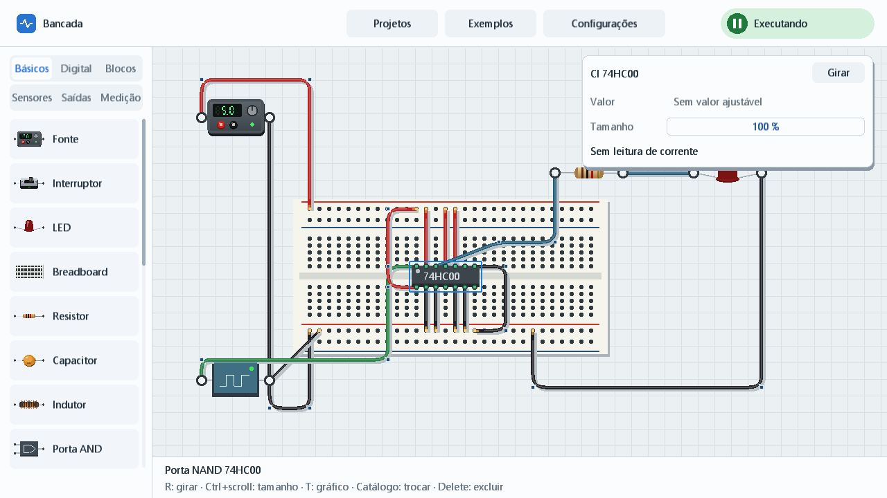

# Bancada

Simulador de circuitos para aprender eletrônica no Windows.
Monte peças e fios, use uma breadboard e observe o circuito funcionar.

## Baixar e usar

Baixe o **[instalador ou ZIP portátil](https://github.com/Reyralona/electronics/releases)** para Windows 10/11 x64.

- **Instalador:** execute o arquivo `-setup.exe`. Não precisa de administrador.
- **ZIP:** extraia a pasta inteira e abra `bancada.exe`.

As dependências estão incluídas. A interface oferece português e inglês.
A versão **0.38.0** é experimental, sem assinatura digital.

Para começar, abra **Exemplos** e escolha **LED na breadboard**.
Dê dois cliques na fonte para ligar ou desligar. O LED acompanha.

## O que dá para fazer

- Montar circuitos com fontes, resistores, portas lógicas, sensores e motores.
- Observar LEDs, displays, corrente nos fios e gráficos.
- Programar placas num subconjunto da linguagem Arduino.
- Criar chips reutilizáveis e salvar projetos.

Os modelos são didáticos. Não use os resultados para dimensionar circuitos reais.
Há limites de 64 peças e 128 fios por montagem.

## Documentação

- [Guia de uso](docs/GUIA.md): controles, projetos e limites dos modelos.
- [Compilar](docs/COMPILAR.md): preparar o ambiente e rodar os testes.
- [Distribuir](docs/DISTRIBUICAO_WINDOWS.md): gerar e publicar os pacotes.
- [Próximos passos](docs/ROADMAP_1_0.md) e [histórico de versões](CHANGELOG.md).
- [Índice dos documentos](docs/README.md).

Escrito em C, com SDL3, OpenGL e ngspice.
Licença [GNU GPL versão 3](LICENSE). As dependências mantêm suas próprias licenças.
